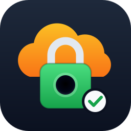

<p align="center">
  
</p>

<h1 align="center">pihole-acme-cloudflare</h1>

<p align="center">
  Trusted HTTPS for the <b>Pi-hole v6</b> web interface: Let's Encrypt certificates via <b>Cloudflare DNS</b>,<br>
  with nothing exposed to the internet. One script, one command, automatic renewal.
</p>

---

## What it does

- Issues a Let's Encrypt (or ZeroSSL) certificate with [acme.sh](https://github.com/acmesh-official/acme.sh) using a Cloudflare DNS challenge. Pi-hole can stay on your LAN, and you don't need to open any ports.
- Installs the certificate into Pi-hole v6 and reloads `pihole-FTL`.
- Renews it automatically through acme.sh's cron job. Before each renewal is installed, the script checks that the certificate hasn't expired and that the key matches it.
- Works with a **native Pi-hole** and with **Pi-hole in Docker**. It finds the container automatically.

It started as an improved, reusable version of [kaczmar2's excellent gist](https://gist.github.com/kaczmar2/17f02a0ddb59a7d336b20376695797c6). Compared to the manual steps in the gist:

| | Gist | This script |
|---|---|---|
| Setup | Copy/paste commands | `install` asks for what it needs, or runs unattended from environment variables |
| Token or zone mistakes | Found out when the CA request fails | Token and zone are checked against the Cloudflare API before the CA is contacted |
| Pi-hole's own cert files | Deleted and replaced | Left alone; Pi-hole is pointed at `tls-acme.pem` through `webserver.tls.cert` |
| Deploy | Inline shell one-liner | Atomic swap, key/cert match check, correct owner and permissions |
| Docker | Not covered | Auto-detected, including the `/etc/pihole` volume path |
| Multiple names / wildcards | Manual | `DOMAINS="pihole.example.com *.lan.example.com"` |
| Domain not on Cloudflare | Not covered | DNS alias mode (`CHALLENGE_ALIAS`) |
| Health check | `openssl` by hand | `status` shows expiry, next renewal and whether the cert is actually served |
| Undo | Manual | `uninstall` |

## Requirements

- Pi-hole **v6**, either native or in Docker (with `/etc/pihole` on a volume).
- A domain whose DNS is on Cloudflare. The free plan is fine.
- `bash`, `curl`, `openssl`, `tar` and `cron`, all running as root.

## Setup

### 1. Create a Cloudflare API token

[dash.cloudflare.com](https://dash.cloudflare.com/profile/api-tokens) → **My Profile → API Tokens → Create Token**

- Start from the **Edit zone DNS** template.
- Add the permission **Zone → Zone → Read**.
- Under **Zone Resources**, select only your domain.

### 2. Point the name at Pi-hole on your LAN

In Pi-hole: **Settings → Local DNS Records**, e.g. `pihole.example.com → 192.168.1.2`.

The name does **not** need to exist in public DNS.

### 3. Install

```bash
curl -fsSLO https://raw.githubusercontent.com/Tntdruid/pihole-acme-cloudflare/main/pihole-acme-cloudflare.sh
sudo bash pihole-acme-cloudflare.sh install
```

The script asks for the hostname, the token and an optional email, then saves them to `/etc/pihole-acme-cloudflare.conf` (chmod 600). Next it installs acme.sh, issues the certificate and loads it into Pi-hole. Once it's done, open `https://pihole.example.com/admin/`.

> **Tip:** to try it without touching Let's Encrypt's rate limits, run `install --staging` first. When that works, run `install --force` to get a real certificate.

#### Unattended

```bash
sudo DOMAINS="pihole.example.com" CF_Token="your-token" bash pihole-acme-cloudflare.sh install -y
```

## Commands

After the first install, the script is available as `pihole-acme-cloudflare`:

| Command | |
|---|---|
| `sudo pihole-acme-cloudflare status` | Certificate names, expiry, next renewal, and whether Pi-hole serves it |
| `sudo pihole-acme-cloudflare renew [--force]` | Renew now if due, or regardless with `--force` |
| `sudo pihole-acme-cloudflare deploy` | Reinstall the current certificate into Pi-hole (acme.sh runs this after each renewal) |
| `sudo pihole-acme-cloudflare install [--force]` | Run again after changing the config, e.g. to add names |
| `sudo pihole-acme-cloudflare uninstall` | Stop renewing and switch Pi-hole back to its self-signed certificate |

## Settings

They live in `/etc/pihole-acme-cloudflare.conf`. On the first run they can also be passed as environment variables.

| Setting | Default | |
|---|---|---|
| `DOMAINS` | – | Names on the certificate, space-separated. Wildcards allowed. The first is the main name. |
| `WEB_DOMAIN` | first non-wildcard | The name you open Pi-hole on (sets `webserver.domain`) |
| `CF_Token` | – | Cloudflare API token |
| `CF_Account_ID` | – | Only needed for account-owned tokens |
| `CF_Zone_ID` | – | Lets the token work without *Zone → Zone → Read* |
| `CHALLENGE_ALIAS` | – | A Cloudflare domain that answers the challenge, for names whose DNS is elsewhere. Needs `_acme-challenge.<name> CNAME _acme-challenge.<alias>` |
| `EMAIL` | – | ACME account email. Optional for Let's Encrypt, required for ZeroSSL. |
| `CA` | `letsencrypt` | `letsencrypt`, `zerossl`, `google`, … (any acme.sh `--server`) |
| `KEY_TYPE` | `ec-256` | `ec-256`, `ec-384`, `2048`, `4096` |
| `DOCKER_CONTAINER` | auto | Pi-hole container name |
| `PIHOLE_DIR` | auto | Host path of `/etc/pihole` |

## How it works

```
acme.sh (cron, daily)
  └─ renews via Cloudflare DNS-01 when due
       └─ writes  /etc/pihole-acme-cloudflare/{key,fullchain}.pem   (root only)
            └─ runs pihole-acme-cloudflare deploy
                 ├─ checks the cert is valid and matches the key
                 ├─ builds /etc/pihole/tls-acme.pem atomically (owner = pihole)
                 ├─ pihole-FTL --config webserver.tls.cert /etc/pihole/tls-acme.pem
                 ├─ pihole-FTL --config webserver.domain <name>
                 └─ restarts pihole-FTL (or the container)
```

## Troubleshooting

- **The browser still says "Not secure".** Open Pi-hole by its **name**, not its IP address. Also check that you're on the HTTPS port listed by `status`. Pi-hole might use `8443` instead of `443`.
- **"Server not found".** The name has no Local DNS Record, or your client doesn't use Pi-hole for DNS.
- **No HTTPS port.** Add one:
  ```bash
  sudo pihole-FTL --config webserver.port '80o,443os,[::]:80o,[::]:443os'
  ```
- **Docker: "Could not set webserver.tls.cert".** An `FTLCONF_webserver_tls_cert` environment variable is locking the setting. Change it to `/etc/pihole/tls-acme.pem`.
- **Migrating from the gist.** Just run `install`. It reuses the existing acme.sh certificate and replaces the old reload command.

## Credits

- [kaczmar2](https://gist.github.com/kaczmar2/17f02a0ddb59a7d336b20376695797c6) for the original guide.
- [acme.sh](https://github.com/acmesh-official/acme.sh) does the ACME work.

This project is not affiliated with Pi-hole or Cloudflare.

## License

[MIT](LICENSE)
